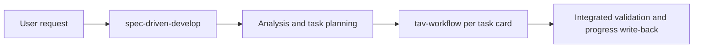

# Project Overview

## Preliminary Direction

Integrate selected engineering disciplines from `asots/mattpocock-skills` into the existing TAV and Spec-Driven workflows without introducing a second orchestration layer or weakening authorization, safety, continuity, and verification contracts.

## Current Architecture

- `D:/WorkSpace/Skills/tav-workflow` is a Markdown-first scoped-change workflow. `SKILL.md` is authoritative; `references/implementation-guide.md` owns operational mechanics; bilingual READMEs and `scripts/verify.ps1` provide user documentation and consistency checks.
- `D:/WorkSpace/Skills/spec-driven-develop` is a Markdown-first multi-agent plugin. The core skill delegates detailed policy to references/templates and agent prompts, with bilingual READMEs, manifest version parity, and two validation scripts.
- The two repositories already share an explicit handoff contract and cross-repository verification fingerprints.

## Technology Stack

| Layer | Current | Target |
|:------|:--------|:-------|
| Workflow definition | Markdown skills and references | Same, with single-sourced specialist disciplines |
| Validation | PowerShell, Bash, Python stdlib, Node syntax check | Existing checks plus semantic fingerprints |
| Distribution | Standalone TAV skill; Claude/Codex/OpenCode/Cursor plugin manifests | Same |
| Tracking | GitHub modes or LOCAL_ONLY | LOCAL_ONLY for this change; no external writes |

## Entry Points

- `tav-workflow/SKILL.md`
- `spec-driven-develop/plugins/spec-driven-develop/skills/spec-driven-develop/SKILL.md`
- `spec-driven-develop/plugins/spec-driven-develop/agents/*.md`
- `tav-workflow/scripts/verify.ps1`
- `spec-driven-develop/scripts/validate.sh`
- `spec-driven-develop/scripts/verify.ps1`

## Build & Run

These repositories are documentation-first and require no build. Relevant validation commands are:

- `pwsh -NoProfile -File scripts/verify.ps1` in `tav-workflow`
- Git Bash with local Python mapping: `scripts/validate.sh` in `spec-driven-develop`
- `pwsh -NoProfile -File scripts/verify.ps1 -TavPath D:\WorkSpace\Skills\tav-workflow` in `spec-driven-develop`
- `git diff --check` in both repositories

## Testing Baseline

- Both repository worktrees were clean before implementation.
- TAV `scripts/verify.ps1` passed at version `3.7.0`.
- Spec-Driven `scripts/verify.ps1` passed at version `1.15.0`, including all cross-repository contract checks.
- Spec-Driven `scripts/validate.sh` passed all seven checks under Git Bash after exposing the installed Windows Python as `python3` for that shell session.

## Project Governance Baseline

- Global user instructions remain the highest project-independent workflow guardrails.
- `spec-driven-develop/AGENTS.md` is the repository-wide source for synchronized workflow surfaces and validation requirements.
- `spec-driven-develop/CLAUDE.md` contains Claude-specific pointers only.
- No repository fallback memory file exists or will be created. Durable progress for this run is `docs/progress/MASTER.md` until archive.

## External Integrations

- Source discipline snapshot: `asots/mattpocock-skills` main commit `ed37663cc5fbef691ddfecd080dff42f7e7e350d`.
- No GitHub Issues, PRs, branches, commits, pushes, or releases are authorized for this task.
