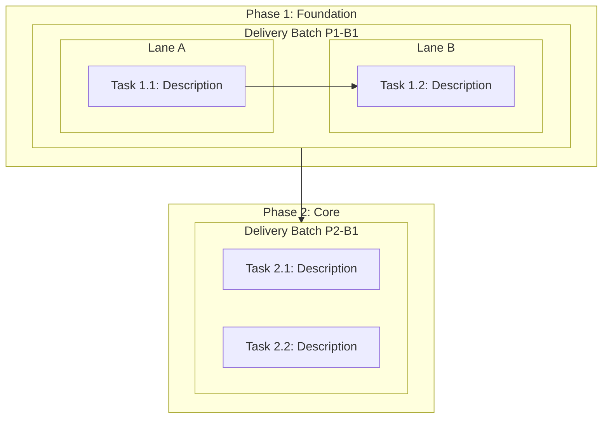

# Plan Document Templates

`docs/plan/task-definition.md` is generated in Phase 2; the three documents below are generated in Phase 3 (Task Decomposition). All live in `docs/plan/`.

---

## task-breakdown.md

```markdown
# Task Breakdown

## Overview
- **Total Phases**: N
- **Total Tasks**: N
- **Planned Delivery Batches / PRs**: N
- **Relative Total Scope**: S/M/L/XL (not a duration estimate)

> **Task-size scale**: S = localized change at one clear boundary; M = one independently verifiable behavior slice; L = recoverable multi-step task card that may need checkpoints; XL = delivery-batch scope only and must be split before task execution.

## S.U.P.E.R Design Constraints

> Each task names only the S.U.P.E.R principles relevant to its changed boundary. The following are adaptable defaults, not a universal scorecard:

- **S (Single Purpose)**: Each new module/file/function solves exactly one problem. If a task spans multiple responsibilities, decompose it further.
- **U (Unidirectional Flow)**: Data flows input → processing → output. Dependencies point inward. No circular imports.
- **P (Ports over Implementation)**: Define interface contracts (schemas, types) before implementation. All cross-module I/O must be serializable.
- **E (Environment-Appropriate)**: Configuration, paths, logs, persistence, and lifecycle follow the supported runtime's explicit convention; do not impose service-only rules on CLI, desktop, embedded, or offline work.
- **R (Replaceable Parts)**: Each component must be replaceable without cascading changes. Validate with the replacement test: "Can I swap this with a different implementation by only touching this module?"

## Testing and Governance Constraints

> These constraints apply to every task unless the task explicitly states why they are not applicable.

- **Tests by default**: Feature work, behavior changes, API/schema/migration changes, parsing, routing, permissions, caching, and persistence changes must add or update relevant automated tests.
- **Explicit test exemption**: Pure documentation/config tasks may mark tests as not applicable, but the acceptance criteria must explain why and name the closest validation command to run.
- **Agent instruction updates**: If a task changes how future agents must work in the repository, update the resolved instruction surfaces such as `AGENTS.md`, `CLAUDE.md`, or existing platform rule files.
- **Memory updates**: If a task introduces a durable rule, invariant, recurring gotcha, command, or project convention, update the resolved native memory surface or explicitly selected repo fallback.
- **Issue/PR separation**: Issues are atomic task and execution-event records; delivery batches are implementation, integration validation, and PR units. Apply the grouping and rationale contract in `references/github-integration.md` "Delivery Batch Execution Workflow".
- **Delivery shape**: Runtime behavior changes default to a vertical tracer slice that delivers one complete behavior path through the relevant layers. Foundation/prefactor, expand, migrate, contract, and integration-gate exceptions require a rationale. Standalone Docs, Governance, Validation, Release, or Archive tasks are allowed with a category, standalone rationale, and concrete acceptance check; follow `references/decomposition-strategy.md`.
- **Domain write-back**: A task that changes canonical terminology, bounded-context relationships, or a qualifying architecture decision updates the relevant glossary/ADR in the same acceptance unit; follow `references/domain-modeling.md`.

## Phase 1: <Phase Name>
**Goal**: What this phase achieves
**Prerequisite**: What must be done before this phase
**S.U.P.E.R Focus**: Which S.U.P.E.R principles are most relevant to this phase (e.g., "P — defining interface contracts before implementing modules")

| # | Task | Priority | Effort | Depends On | Affected Files | Lane | Delivery Batch | Delivery Shape | S.U.P.E.R | Test Expectation | Governance Impact | Rollback | Acceptance Criteria |
|:--|:-----|:---------|:-------|:-----------|:---------------|:-----|:---------------|:---------------|:----------|:-----------------|:------------------|:---------|:--------------------|
| 1 |      | P0       | M      | —          | `src/...`, `tests/...` | A | P1-B1 | Vertical tracer slice | S, P | Add/update tests | Update resolved memory surface if new invariant emerges | Revert this task's isolated change |                     |
| 2 | Docs: update the operator guide | P1 | S | — | `docs/...` | B | P1-B1 | Docs standalone task | U, E | Not applicable: docs-only; run link check | None | Revert docs-only change | Links and examples resolve |
| 3 |      | P1 | S | 1 | `src/...` | A | P1-B1 | Vertical tracer slice | R | Add/update regression tests | Update resolved instruction surfaces if workflow rule changes | Revert task-specific change |                     |

> **S.U.P.E.R column**: Lists which S.U.P.E.R principles are the primary design drivers for this task. The agent implementing this task must pay special attention to these principles. Every task's acceptance criteria implicitly includes: "Passes the S.U.P.E.R Quick Check for the listed principles."
> **Test Expectation column**: Must name the expected test work or the explicit no-test rationale plus closest validation command.
> **Governance Impact column**: Must state whether the task can affect the resolved memory surface or any resolved instruction surface.
> **Affected Files column**: Names the expected files, modules, contracts, or prerequisites. The execution event records only items discovered beyond this declared boundary as unplanned dependencies.
> **Delivery Batch column**: Every task belongs to exactly one planned PR batch. The batch may contain several Issues even though each task becomes its own Issue.
> **Delivery Shape and Rollback columns**: State the vertical-slice or permitted exception rationale, plus the smallest safe reversal boundary for the task.
> **Task description**: For runtime behavior changes, name the observable vertical behavior. Prefix behavior-shape exceptions with `Prefactor`, `Expand`, `Migrate`, `Contract`, or `Integration gate`. Prefix standalone operational work with `Docs`, `Governance`, `Validation`, `Release`, or `Archive`; every exception includes its rationale and acceptance check in the detail section.

### Parallel Lanes
| Lane | Tasks | Combined Effort | Merge Risk | Key Files |
|:-----|:------|:----------------|:-----------|:----------|
| A    | 1, 3  | M               | Low        |           |
| B    | 2     | S               | Low        |           |

> Tasks in different lanes have no mutual dependencies and may be executed simultaneously only when the Tier 2 admission criteria pass, including confirmed explicit branch/worktree and commit authorization. Lane agents return one accepted atomic commit per task card and never open task-level PRs. Without both authorizations, execute at Tier 0 or Tier 1 on the current/integration worktree instead of returning uncommitted lane worktrees. Merge risk indicates the likelihood of file conflicts before integration into the delivery batch branch.

### Delivery Batches

| Batch | Tasks / Issues | Execution Waves | Goal and Grouping Rationale | Integration Branch | Planned Tier / Authority Prerequisite | Combined Validation | Depends On | Split / Single-Issue Rationale |
|:------|:---------------|:----------------|:----------------------------|:-------------------|:-------------------------------------|:--------------------|:-----------|:-------------------------------|
| P1-B1 | 1, 2, 3 / #TBD | W1: Lane A (T1 → T3) + Lane B (T2) | One coherent architecture and review unit | `batch/<run-id>/p1-b1-<slug>` | Tier 2; branch/worktree + commit authorization required before dispatch | targeted tests + full affected build/smoke | — | Default phase-level batch |

> Review the complete phase task set before defining batches. Apply the authoritative grouping, reviewability, and split-rationale rules in `references/github-integration.md` "Delivery Batch Execution Workflow".

## Phase 2: <Phase Name>
<!-- Same structure as Phase 1 -->
```

---

## dependency-graph.md

````markdown
# Task Dependency Graph


````

---

## milestones.md

```markdown
# Milestones

| # | Milestone | Target Phase | Criteria | Status |
|:--|:----------|:-------------|:---------|:-------|
| 1 |           | After Phase 1|          | Pending |
| 2 |           | After Phase 3|          | Pending |
```
